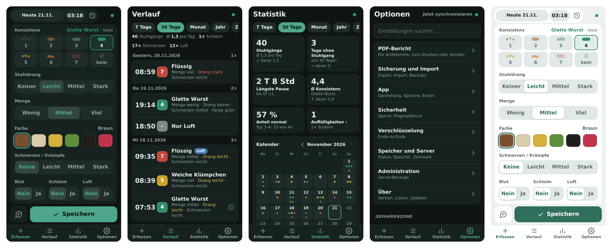
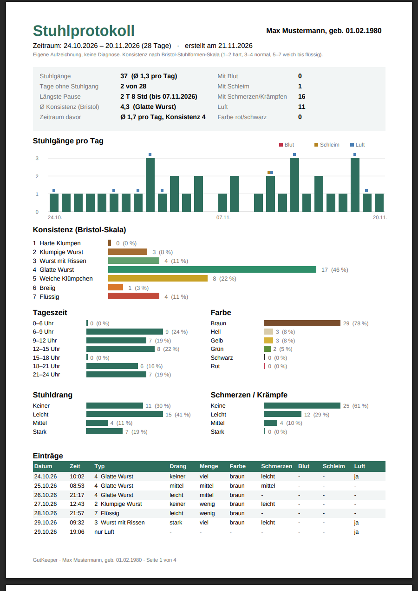

<div align="center">


# GutKeeper

### DarmWächter – dein Darmtagebuch

[English](README.md) · **Deutsch**

[](https://github.com/JamDevLab/GutKeeper/releases/latest)
[](LICENSE)
[](https://github.com/JamDevLab/GutKeeper/actions/workflows/test.yml)

</div>

Selbst gehostetes **Darm-Tagebuch** für das Handy: Stuhlgänge in wenigen Sekunden erfassen, im Verlauf und in der Statistik auswerten und als PDF-Bericht exportieren (z. B. zum Mitnehmen zum Arzttermin). Die App läuft als **PWA** (installierbar, offline nutzbar) auf einem kleinen Server im eigenen Netz. Deine Daten bleiben bei dir.

Ein quelloffenes **Stuhltagebuch** (Darmtagebuch) mit **Bristol-Stuhlskala**, um Verdauung, Beschwerden und mögliche Auslöser im Alltag selbst zu dokumentieren.



> **Hinweis:** GutKeeper dient der eigenen Aufzeichnung und ersetzt keine ärztliche Beratung, Untersuchung oder Diagnose. Bei Blut im Stuhl, anhaltenden Beschwerden oder Unsicherheit wende dich an eine Ärztin oder einen Arzt. Siehe [Haftungsausschluss](#haftungsausschluss-und-lizenz).

> **Sprache:** Die Oberfläche gibt es auf Deutsch und Englisch. Umschalten unter *Optionen* → *App* → *Sprache / Language*; ohne Auswahl richtet sich die App nach der Sprache des Browsers.

## Funktionen

- **Schnell erfassen** auf einer Seite, ohne Scrollen: Konsistenz (Bristol-Skala 1–7 oder „kein Stuhl“), Stuhldrang, Menge, Farbe, Schmerzen/Krämpfe, Blut, Schleim, Luft und optional eine Notiz. Auch ohne Stuhl lassen sich Drang, Schmerzen, Blut, Schleim und Luft angeben (nur Menge und Farbe entfallen). Datum und Uhrzeit sind immer auf „jetzt“ vorbelegt, die letzte Auswahl wird gemerkt. Eine Notiz lässt sich mit „Merken“ für die nächsten Einträge behalten (z. B. „Krank“).
- **Notiz-Schlagwörter:** Schnellwahl-Chips für die Notiz (antippen = hinzufügen, nochmal antippen = entfernen). Die Liste lässt sich bearbeiten (langes Drücken oder ✎: umbenennen, löschen, neue anlegen, Standard wiederherstellen) und liegt nur auf dem Gerät.
- **PDF-Bericht** (*Optionen → PDF-Bericht*) für Zeitraum und Umfang deiner Wahl, direkt im Browser erzeugt, z. B. für die Arztpraxis. Jeder Bericht enthält dieselben Auswertungen: Zusammenfassung, Stuhlgänge pro Tag, Konsistenz, Tageszeit, Farbe, Stuhldrang und Schmerzen. Die drei Umfänge unterscheiden sich nur bei den Einträgen: **Kurz** (nur die Auffälligkeiten, mit Essen zusätzlich das Essen der 24 Stunden davor), **Normal** (alle Einträge als kompakte Tabelle mit Notizen) und **Ausführlich** (alle Einträge, jede Angabe in eigener Spalte). Immer dabei: Vergleich mit dem gleich langen Zeitraum davor und hervorgehobene Einträge mit Blut oder roter bzw. schwarzer Farbe (neutral markiert, ohne Bewertung). Beim Erstellen fragt ein Dialog optional nach Name und Geburtsdatum (stehen nur im PDF) und ob das Essen dazukommt; auf Wunsch merkt sich das Gerät die Angaben (verschlüsselt). Dazu eine **Schwarz-Weiß-Option** für Drucker ohne Farbe und ein optionaler **Passwortschutz** (AES-256, PDF 2.0; das Passwort wird nicht gespeichert). Siehe [Beispiel-Bericht](#beispiel-bericht).
- **Ältere Einträge ansehen**, auch wenn das Gerät nur die letzten Monate speichert: Sie werden bei bestehender Verbindung live vom Server geladen (wenige KB, nicht auf dem Gerät gespeichert).
- **Essen (optional, standardmäßig aus):** Unter *Optionen → App → Essen aufzeichnen* einschalten. Dann gibt es im Tab *Erfassen* oben rechts einen kleinen Knopf (Toilette | Gabel) zum Wechseln, um grob einzutragen, was du gegessen hast (z. B. „Pizza“), mit Schnellwahl der zuletzt gegessenen Speisen. Siehe [Essen](docs/CONFIGURATION.de.md#essen-optional).
- **Verlauf** mit Wischgesten (bearbeiten/löschen), Filter für 7/30 Tage, Monat, Jahr, freien Zeitraum und alles. Der Stuhldrang (leicht/mittel/stark) ist farbig hervorgehoben (gelb, orange, rot); abschaltbar unter *Optionen → App* („Stuhldrang im Verlauf farbig“). Dazu eine **Jahresübersicht** als Heatmap.
- **Statistik**: Kennzahlen mit Vergleich zum gleich langen Zeitraum davor (nur Richtung, ohne Wertung), Anteil normaler Stühle (Typ 3–4), Auffälligkeiten (antippen klappt Blut, Schleim, Schmerzen und Luft auf, von dort geht es zu den Einträgen im Verlauf), Kalender (Tag antippen öffnet ihn im Verlauf), Stuhlgänge pro Tag/Woche, Ø Konsistenz als Verlauf mit hinterlegtem Normalbereich, Verteilung der Konsistenz, Tageszeit, Wochentag, Drang, Menge, Farbe, Schmerzen.
- **Offline-first**: Einträge werden zuerst auf dem Gerät gespeichert und automatisch mit dem Server abgeglichen, sobald er erreichbar ist (zu Hause oder per VPN). Mehrere Geräte bleiben synchron.
- **Anmeldung mit Passwort:** Beim ersten Start legst du in der App ein Passwort fest (Einmal-Code aus dem Server-Log). Auf jedem Gerät meldest du dich einmal an und bleibst angemeldet, bis du dich abmeldest. Dazu eine **optionale App-Sperre** nur für das jeweilige Gerät: eine lokale PIN, optional **Entsperren mit Fingerabdruck oder Gesicht** (WebAuthn, nur über HTTPS), beides unter *Optionen → Sicherheit* (bzw. *Konto und Sicherheit*) einzurichten. Die PIN verlässt das Gerät nie.
- **Speicherverbrauch** von Gerät und Server auf einen Blick (Datenbank, Backups, freier Platz).
- **Backups**: tägliche Sicherungen auf dem Server (anlegen, herunterladen, zurückspielen, löschen), dazu JSON-/CSV-Export und -Import. Backups und Exporte lassen sich **mit Passwort verschlüsselt** herunterladen (AES-256-GCM). Die Android-App sichert auf Wunsch automatisch (verschlüsselt) in *Dokumente/GutKeeper*, ohne Server erinnert die App an fällige Backups.
- **Verschlüsselung:** lokaler Speicher verschlüsselt (automatisch), optional Ende-zu-Ende-Verschlüsselung mit Wiederherstellungscode, siehe [Verschlüsselung](docs/DATA.de.md#verschlüsselung).
- **Mehrere Konten (optional):** jede Person mit eigenem Konto und getrennten Daten, siehe [Mehrere Konten](docs/CONFIGURATION.de.md#mehrere-konten-optional).
- **Auch ohne Server nutzbar:** als reine Web-App oder Android-App, alle Daten bleiben auf dem Gerät, siehe [Ohne Server](docs/CONFIGURATION.de.md#ohne-server-nur-dateien-alle-daten-bleiben-auf-dem-gerät).
- **Geführter Einstieg:** Beim ersten Start fragt ein kurzer Dialog Sprache, Darstellung, Essen, App-Sperre, Verschlüsselung und Backups ab. Jeder Schritt lässt sich überspringen; Betreiber schalten ihn mit `ONBOARDING=0` ab.
- **Deutsch und Englisch** (Umschalter unter *Optionen → App*; ohne eigene Wahl folgt die App der Browser-Sprache).
- Hell-/Dunkelmodus, kompakt für Smartphones optimiert, keine externen Dienste, keine Tracker.

## Beispiel-Bericht

So sieht Seite 1 des ausführlichen PDF-Berichts aus (Demodaten, mit Essen). Die ganze Datei: [`docs/beispiel-bericht.pdf`](docs/beispiel-bericht.pdf).

[](docs/beispiel-bericht.pdf)

## Schnellstart (Docker)

Voraussetzung: Docker mit Compose.

> **Nur im eigenen Netz betreiben:** GutKeeper ist für das Heimnetz gedacht (LAN, unterwegs per VPN wie WireGuard oder Tailscale). Gib den Port nicht im Router frei und stelle die App nicht offen ins Internet, auch nicht über einen Reverse Proxy. Der Server lehnt Anfragen von öffentlichen Adressen ab (siehe [Sicherheit](docs/DATA.de.md#sicherheit-und-datenschutz)).

Lege einen leeren Ordner an (z. B. `~/gutkeeper`) mit dieser `compose.yml`:

```yaml
services:
  gutkeeper:
    image: ghcr.io/jamdevlab/gutkeeper:1   # 1 = immer die neueste 1.x
    container_name: gutkeeper
    restart: unless-stopped
    user: "1000:1000"                       # muss in ./data schreiben dürfen
    cap_drop: [ALL]                         # Härtung: keine Capabilities,
    security_opt: ["no-new-privileges:true"] # keine Rechteausweitung,
    read_only: true                         # Dateisystem schreibgeschützt
    tmpfs: [/tmp]
    ports:
      - "3000:3000"
    environment:
      TZ: Europe/Berlin
      # MULTIUSER: "1"                      # mehrere Konten mit Name und Passwort
      # FOOD_DEFAULT: "1"                   # „Essen aufzeichnen“ standardmäßig an
      # CORS_ORIGINS: https://localhost     # Android-App (APK) darf sich verbinden
      # BACKUP_KEEP: "30"                   # Anzahl aufbewahrter Server-Backups
      # BACKUP_PASSWORD: ${BACKUP_PASSWORD} # verschlüsselt die Backups; Wert in eine .env neben dieser Datei
    volumes:
      - ./data:/data
```

```bash
docker compose up -d      # lädt das fertige Image von ghcr.io
docker compose logs       # zeigt beim ersten Start den Einmal-Code für die Einrichtung
```

Oder aus dem Repository, mit allen Einstellungen in einer `.env`:

```bash
git clone https://github.com/JamDevLab/GutKeeper.git
cd GutKeeper
cp .env.example .env      # Einstellungen anpassen (alles ist optional)
docker compose up -d
```

Die `docker-compose.yml` dort enthält die wichtigsten Einstellungen, [`compose/all-options.yml`](compose/all-options.yml) alle Optionen (Reverse Proxy, App-Name, Icon …).

Danach im Browser `http://<server-ip>:3000` öffnen. Beim ersten Öffnen verlangt die App den **Einmal-Code** aus `docker compose logs` und legt dein **Passwort** fest (mindestens 8 Zeichen). Das Passwort liegt nur als Hash in der Datenbank, nicht in der `.env`. Danach bleibt jedes Gerät nach der Anmeldung angemeldet; eine PIN oder den Fingerabdruck für das Gerät richtest du unter *Optionen → Sicherheit* ein. Das Passwort ändern oder zurücksetzen: siehe [Anmeldung und Sitzungen](docs/DATA.de.md#sicherheit-und-datenschutz). Zum Ausprobieren kannst du unter **Optionen → Sicherung und Import → Importieren** die Datei [`docs/demo-data.csv`](docs/demo-data.csv) einlesen.

Ohne Docker (Node.js ≥ 22.13): `npm start`. Der Server hat keine Abhängigkeiten, es ist kein `npm install` nötig.

Mehr zum Docker-Betrieb (Vorlagen, Image-Tags, Updates, Schreibrechte): [Docker im Detail](docs/CONFIGURATION.de.md#docker-im-detail).

## Wege, GutKeeper zu nutzen

- **Server mit Docker:** der übliche Weg. Ein kleiner Server im Heimnetz speichert die Daten und hält alle deine Geräte synchron. Siehe [Schnellstart](#schnellstart-docker) und [Docker im Detail](docs/CONFIGURATION.de.md#docker-im-detail).
- **Ohne Server, als reine Dateien:** `npm run build:static` erzeugt einen Ordner mit statischen Dateien. Alle Daten bleiben auf dem Gerät, einen Abgleich gibt es nicht. Siehe [Ohne Server](docs/CONFIGURATION.de.md#ohne-server-nur-dateien-alle-daten-bleiben-auf-dem-gerät).
- **Als App auf dem Handy:** über HTTPS kann der Browser GutKeeper wie eine App installieren, auch offline. Siehe [Als App auf dem Handy installieren](docs/CONFIGURATION.de.md#als-app-auf-dem-handy-installieren) und [HTTPS einrichten](docs/CONFIGURATION.de.md#https-einrichten).
- **Android-App (APK):** eine fertige APK hängt an jedem Release. Sie läuft ohne Server oder verbindet sich mit deinem. Siehe [Android-App (APK)](docs/CONFIGURATION.de.md#android-app-apk).

Alle Wege mit Anleitungen für Android und iPhone: [docs/INSTALLATION.de.md](docs/INSTALLATION.de.md).

## Sicherheit kurz

- Nur Heimnetz oder VPN: der Server lehnt Anfragen von öffentlichen Adressen ab. Leite den Port nicht am Router weiter.
- Anmeldung mit Passwort, dazu eine optionale PIN oder Fingerabdruck-Sperre, die nur für das jeweilige Gerät gilt.
- Optionale Ende-zu-Ende-Verschlüsselung, dann liegen auf dem Server und in seinen Backups nur verschlüsselte Daten.
- Keine Tracker, keine Fremd-Schriften oder -Skripte und keine externen Anfragen.

Details: [Sicherheit und Datenschutz](docs/DATA.de.md#sicherheit-und-datenschutz) und [Verschlüsselung](docs/DATA.de.md#verschlüsselung).

## Bekannte Grenzen

- Standardmäßig für **eine Person** gedacht. Mehrere Personen sind mit `MULTIUSER=1` möglich; ohne eingeschaltete Ende-zu-Ende-Verschlüsselung kann der Admin die Daten lesen (siehe [Sicherheit](docs/DATA.de.md#sicherheit-und-datenschutz)).
- Die Server-Datenbank ist nur mit eingeschalteter Ende-zu-Ende-Verschlüsselung verschlüsselt. Geht bei aktiver Verschlüsselung der Wiederherstellungscode und jedes freigeschaltete Gerät verloren, sind die Daten weg (siehe [Verschlüsselung](docs/DATA.de.md#verschlüsselung)).
- Oberfläche auf **Deutsch und Englisch** (weitere Sprachen sind nicht vorgesehen).
- Chrome auf Android ist das Hauptziel. Andere moderne Browser funktionieren, die Installation als App kann abweichen.
- Zum Installieren und für den Offline-Betrieb ist HTTPS nötig.

## Dokumentation

- [docs/INSTALLATION.de.md](docs/INSTALLATION.de.md): die drei Installationswege, mit Anleitungen für Android und iPhone
- [docs/CONFIGURATION.de.md](docs/CONFIGURATION.de.md): Docker im Detail, serverlose Version, HTTPS, Umgebungsvariablen, Essen, mehrere Konten, App-Icon
- [docs/DATA.de.md](docs/DATA.de.md): Verschlüsselung, Sicherheit und Datenschutz, Sync, Backups, CSV-Format
- [docs/DEVELOPMENT.de.md](docs/DEVELOPMENT.de.md): Projektstruktur, Tests, Übersetzungen, Hilfsskripte
- [CHANGELOG.md](CHANGELOG.md): Änderungen je Version
- [SECURITY.md](SECURITY.md): Sicherheitslücken melden
- [CONTRIBUTING.md](CONTRIBUTING.md): Mitwirken, einschließlich CLA
- [THIRD-PARTY-NOTICES.md](THIRD-PARTY-NOTICES.md): Fremdkomponenten und ihre Lizenzen

## Haftungsausschluss und Lizenz

GutKeeper ist **kein Medizinprodukt**. Die Auswertungen und der Bericht sind eine Hilfe zur eigenen Dokumentation, keine Diagnose und keine Therapieempfehlung. Sie ersetzen keine ärztliche Beratung, Untersuchung oder Diagnose. Die Nutzung erfolgt auf eigene Verantwortung; der Quelltext wird ohne Gewähr bereitgestellt (siehe AGPL-3.0, §15 und §16). Für deine Daten und deren Sicherung (Backups) bist du selbst verantwortlich. Sicherheitslücken meldest du privat, siehe [SECURITY.md](SECURITY.md).

Lizenz: [GNU Affero General Public License v3.0](LICENSE), nur Version 3 (AGPL-3.0-only). Copyright (C) 2026 JamDevLab. Fremde Komponenten in der Android-App und im Docker-Image und ihre Lizenzen: [THIRD-PARTY-NOTICES.md](THIRD-PARTY-NOTICES.md).

Du darfst GutKeeper frei nutzen, verändern und weitergeben. Wenn du eine **veränderte Version** weitergibst **oder anderen über ein Netzwerk als Dienst anbietest**, musst du den Quellcode deiner Version unter derselben Lizenz bereitstellen (AGPL §13).

## Entwicklung mit KI

Dieses Projekt wurde mit Unterstützung von KI-Werkzeugen (Claude von Anthropic) entwickelt. Konzept, Anforderungen, Auswahl und Prüfung der Ergebnisse liegen beim Autor. Der Code ist durch automatische Tests abgedeckt (`npm test`), wurde aber nicht unabhängig geprüft. Prüfe ihn vor dem Einsatz mit sensiblen Gesundheitsdaten selbst oder lass ihn prüfen. Fehler meldest du bitte als Issue, Sicherheitslücken privat (siehe [SECURITY.md](SECURITY.md)).

## Mitwirken

Beiträge sind willkommen. Bitte lies vorher [CONTRIBUTING.md](CONTRIBUTING.md); dort steht auch die Beitragsvereinbarung (CLA), der du mit einem Pull Request zustimmst.
