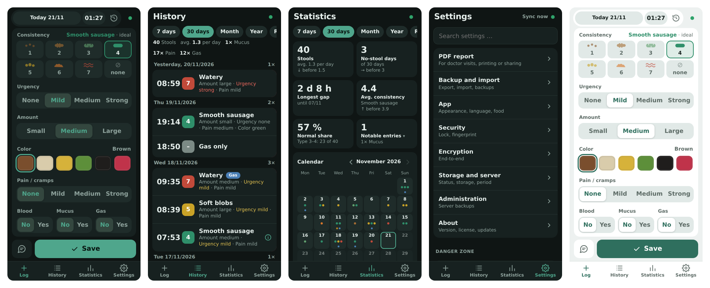
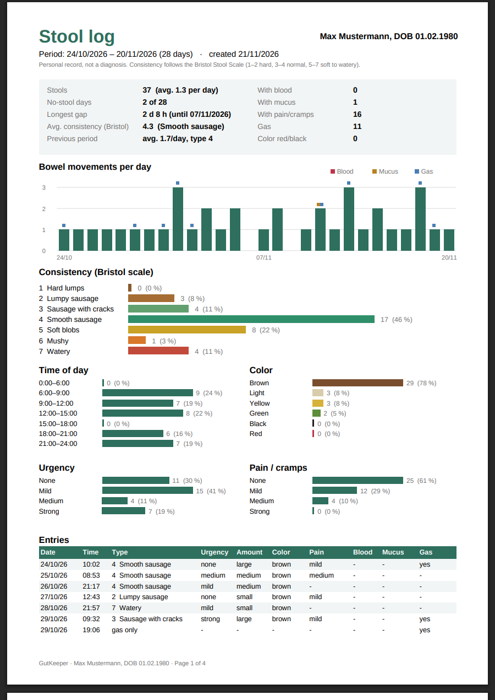

<div align="center">


# GutKeeper

### Your self-hosted bowel diary

**English** · [Deutsch](README.de.md)

[](https://github.com/JamDevLab/GutKeeper/releases/latest)
[](LICENSE)
[](https://github.com/JamDevLab/GutKeeper/actions/workflows/test.yml)

</div>

A self-hosted bowel movement diary for your phone: log stools in a few seconds, review them in the history and statistics, and export a PDF report (for example to take to a doctor's appointment). The app is a PWA (installable, works offline) that runs on a small server on your own network. Your data stays with you.

An open-source stool diary (bowel diary, bowel movement tracker) with the Bristol stool scale, to document your digestion, symptoms and possible triggers in everyday life.



> **Note:** GutKeeper is for your own record keeping and does not replace medical advice, examination or diagnosis. If you notice blood in your stool, have persistent symptoms or are unsure, please see a doctor. See [Disclaimer and license](#disclaimer-and-license).

> **Language:** The interface is available in English and German. Switch under *Settings* → *App* → *Sprache / Language*; without a choice the app follows your browser language.

## Features

- Quick entry on one screen, no scrolling: consistency (Bristol scale 1–7, or "no stool"), urgency, amount, color, pain/cramps, blood, mucus, gas and an optional note. Date and time default to "now", the last selection is remembered. A note can be kept for the next entries (e.g. "Sick").
- Note tags: quick-pick chips for the note (tap to add, tap again to remove). The list is editable (long-press or ✎: rename, delete, add, restore defaults) and is stored on the device only.
- PDF report (*Settings → PDF report*) for the period and size of your choice, generated directly in the browser, e.g. for the doctor's office. Every report contains the same analyses: summary, stools per day, consistency, time of day, color, urgency and pain. The three sizes differ only in the entries: **Short** (only the notable entries, with food also the food of the 24 hours before), **Normal** (all entries as a compact table with notes) and **Detailed** (all entries, each detail in its own column). Always included: comparison with the previous period of the same length and highlighted entries with blood or red/black color (marked neutrally, without assessment). When creating it, a dialog optionally asks for name and date of birth (only in the PDF) and whether to include food; on request the device remembers the entries (encrypted). There is also a black-and-white option for printers without color and optional password protection (AES-256, PDF 2.0; the password is not stored). See [Example report](#example-report).
- Older entries stay viewable even if the device only stores the last few months: with a connection they are loaded live from the server (a few KB, not stored on the device).
- Food (optional, off by default): turn it on under *Settings → App → Log food*. The *Log* tab then gets a small button at the top right (toilet | fork) to switch, to log roughly what you ate (e.g. "pizza"), with quick picks of recently eaten foods. See [Food](docs/CONFIGURATION.md#food-optional).
- History with swipe gestures (edit/delete), filters for 7/30 days, month, year, custom range and all. There is also a year overview as a heatmap. Urgency (mild/medium/strong) is color-highlighted (yellow, orange, red); this can be turned off under *Settings → App* ("Color-code urgency in history").
- Statistics: key figures with a comparison to the previous period of the same length (direction only, no judgement), share of normal stools (type 3–4), notable entries (tap to expand blood, mucus, pain and gas, with a link to those entries in the history), calendar (tap a day to open it in the history), stools per day/week, average consistency over time with the normal range shaded, distribution of consistency, time of day, weekday, urgency, amount, color, pain.
- Offline first: entries are saved on the device first and synced automatically with the server when it is reachable (at home or via VPN). Several devices stay in sync.
- Sign-in with a password: on first start you set a password in the app (one-time code from the server log). You sign in once on each device and stay signed in until you sign out. On top of that there is an optional app lock just for that device: a local PIN, optionally unlock with fingerprint or face (WebAuthn, HTTPS only), both set up under *Settings → Security* (with multiple accounts *Account and security*). The PIN never leaves the device.
- Storage usage of device and server at a glance (database, backups, free space).
- Backups: daily backups on the server (create, download, restore, delete), plus JSON/CSV export and import. Backups and exports can be downloaded password-encrypted (AES-256-GCM). On request the Android app also backs up automatically (encrypted) to *Documents/GutKeeper*; without a server the app reminds you when a backup is due.
- Encryption: encrypted local storage (automatic), optional end-to-end encryption with a recovery code, see [Encryption](docs/DATA.md#encryption).
- Multiple accounts (optional): one account per person with separate data, see [Multiple accounts](docs/CONFIGURATION.md#multiple-accounts-optional).
- Works without a server too: as a plain web app or Android app, all data stays on the device, see [Without a server](docs/CONFIGURATION.md#without-a-server-just-files-all-data-stays-on-the-device).
- Guided first-run dialog: on first start a short dialog asks for language, appearance, food, app lock, encryption and backups. Every step can be skipped; operators turn it off with `ONBOARDING=0`.
- English and German interface (switch under *Settings* → *App* → *Sprache / Language*, otherwise the browser language is used).
- Light/dark mode, compact layout optimized for smartphones, no external services, no trackers.

## Example report

This is page 1 of the detailed PDF report (demo data, with food). The full file: [`docs/example-report.pdf`](docs/example-report.pdf).

[](docs/example-report.pdf)

## Quick start (Docker)

Requirement: Docker with Compose.

> **Run it on your own network only:** GutKeeper is meant for your home network (LAN, on the go via a VPN such as WireGuard or Tailscale). Do not forward the port on your router and do not expose the app to the open internet, not even through a reverse proxy. The server rejects requests from public addresses (see [Security](docs/DATA.md#security-and-privacy)).

Create an empty folder (e.g. `~/gutkeeper`) with this `compose.yml`:

```yaml
services:
  gutkeeper:
    image: ghcr.io/jamdevlab/gutkeeper:1   # 1 = always the latest 1.x
    container_name: gutkeeper
    restart: unless-stopped
    user: "1000:1000"                       # must be able to write to ./data
    cap_drop: [ALL]                         # hardening: no capabilities,
    security_opt: ["no-new-privileges:true"] # no privilege escalation,
    read_only: true                         # read-only file system
    tmpfs: [/tmp]
    ports:
      - "3000:3000"
    environment:
      TZ: Europe/Berlin
      # MULTIUSER: "1"                      # several accounts with name and password
      # FOOD_DEFAULT: "1"                   # "Log food" on by default
      # CORS_ORIGINS: https://localhost     # lets the Android app (APK) connect
      # BACKUP_KEEP: "30"                   # number of server backups kept
      # BACKUP_PASSWORD: ${BACKUP_PASSWORD} # encrypts server backups; put the value in a .env next to this file
    volumes:
      - ./data:/data
```

```bash
docker compose up -d      # pulls the prebuilt image from ghcr.io
docker compose logs       # shows the one-time setup code on first start
```

Or from the repository, with all settings in a `.env`:

```bash
git clone https://github.com/JamDevLab/GutKeeper.git
cd GutKeeper
cp .env.example .env      # adjust settings (everything is optional)
docker compose up -d
```

The `docker-compose.yml` there covers the most important settings; [`compose/all-options.yml`](compose/all-options.yml) has every option (reverse proxy, app name, icon …).

Then open `http://<server-ip>:3000` in your browser. On first open the app asks for the one-time code from `docker compose logs` and sets your password (at least 8 characters). The password is stored only as a hash in the database, not in `.env`. After signing in, each device stays signed in; you set up a PIN or fingerprint for the device under *Settings → Security*. Changing or resetting the password: see [Security and privacy](docs/DATA.md#security-and-privacy). To try it out, import the file [`docs/demo-data.csv`](docs/demo-data.csv) under **Settings → Backup and import → Import**.

Without Docker (Node.js ≥ 22.13): `npm start`. The server has no dependencies, so no `npm install` is needed.

More about the Docker setup (templates, image tags, updates, write permissions): [Docker in detail](docs/CONFIGURATION.md#docker-in-detail).

## Ways to use GutKeeper

- **Server with Docker:** the usual setup. A small server in your home network stores the data and keeps all your devices in sync. See the [quick start](#quick-start-docker) and [Docker in detail](docs/CONFIGURATION.md#docker-in-detail).
- **Without a server, as plain files:** `npm run build:static` creates a folder of static files. All data stays on the device, there is no sync. See [Without a server](docs/CONFIGURATION.md#without-a-server-just-files-all-data-stays-on-the-device).
- **As an app on the phone:** over HTTPS the browser can install GutKeeper like an app and it works offline. See [Install as an app on your phone](docs/CONFIGURATION.md#install-as-an-app-on-your-phone) and [Setting up HTTPS](docs/CONFIGURATION.md#setting-up-https).
- **Android app (APK):** a ready-made APK is attached to every release. It runs without a server or connects to yours. See [Android app (APK)](docs/CONFIGURATION.md#android-app-apk).

All ways, with instructions for Android and iPhone: [docs/INSTALLATION.md](docs/INSTALLATION.md).

## Security in brief

- Home network or VPN only: the server rejects requests from public addresses. Do not forward the port on your router.
- Password sign-in, plus an optional PIN or fingerprint lock that applies to one device only.
- Optional end-to-end encryption, so the server and its backups only hold ciphertext.
- No trackers, no third-party fonts or scripts and no external requests.

Details: [Security and privacy](docs/DATA.md#security-and-privacy) and [Encryption](docs/DATA.md#encryption).

## Known limitations

- Intended for one person by default. Several people are possible with `MULTIUSER=1`; without end-to-end encryption turned on the admin can read the data (see [Security](docs/DATA.md#security-and-privacy)).
- The server database is only encrypted with end-to-end encryption turned on. If the recovery code and every unlocked device are lost while it is active, the data is gone (see [Encryption](docs/DATA.md#encryption)).
- Interface in German and English only (no other languages planned).
- Chrome on Android is the main target. Other modern browsers work, installing as an app may differ.
- Installing and offline use require HTTPS.

## Documentation

- [docs/INSTALLATION.md](docs/INSTALLATION.md): the three ways to install, with instructions for Android and iPhone
- [docs/CONFIGURATION.md](docs/CONFIGURATION.md): Docker in detail, serverless build, HTTPS, environment variables, food, multiple accounts, app icon
- [docs/DATA.md](docs/DATA.md): encryption, security and privacy, sync, backups, CSV format
- [docs/DEVELOPMENT.md](docs/DEVELOPMENT.md): project structure, tests, translations, helper scripts
- [CHANGELOG.md](CHANGELOG.md): changes per version (in German)
- [SECURITY.md](SECURITY.md): how to report a vulnerability
- [CONTRIBUTING.md](CONTRIBUTING.md): how to contribute, including the CLA
- [THIRD-PARTY-NOTICES.md](THIRD-PARTY-NOTICES.md): third-party components and their licenses

## Disclaimer and license

GutKeeper is **not a medical device**. The evaluations and the report are an aid for your own documentation, not a diagnosis and not a treatment recommendation. They do not replace medical advice, examination or diagnosis. Use is at your own risk; the source code is provided without warranty (see AGPL-3.0, sections 15 and 16). You are responsible for your data and its backups. Report security vulnerabilities privately, see [SECURITY.md](SECURITY.md).

License: [GNU Affero General Public License v3.0](LICENSE), version 3 only (AGPL-3.0-only). Copyright (C) 2026 JamDevLab. Third-party components in the Android app and the Docker image and their licenses: [THIRD-PARTY-NOTICES.md](THIRD-PARTY-NOTICES.md).

You may use, modify and share GutKeeper freely. If you distribute a modified version or offer it to others as a service over a network, you must make the source code of your version available under the same license (AGPL §13).

## Developed with AI

This project was developed with the help of AI tools (Claude by Anthropic). The concept, requirements, selection and review of the results are the author's responsibility. The code is covered by automated tests (`npm test`) but has not been independently audited. Review it yourself, or have it reviewed, before using it with sensitive health data. Please report bugs as an issue and security vulnerabilities privately (see [SECURITY.md](SECURITY.md)).

## Contributing

Contributions are welcome. Please read [CONTRIBUTING.md](CONTRIBUTING.md) first; it also contains the contributor license agreement (CLA) you accept with a pull request.
