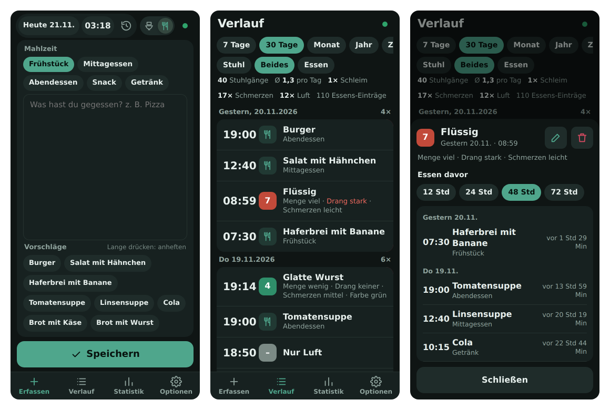

# Konfiguration

[English](CONFIGURATION.md) · **Deutsch**

[Zurück zur README](../README.de.md)

## Docker im Detail

Der [Schnellstart in der README](../README.de.md#schnellstart-docker) zeigt eine kurze `compose.yml`. Compose-Dateien im Repository:

- `docker-compose.yml`: die wichtigsten Einstellungen (Zeitzone, mehrere Konten, Essen, Verbindung der APK, Server-Backups in `./data/backups`), Werte aus der `.env`. Gehärtet: keine Linux-Capabilities, keine Rechteausweitung, schreibgeschütztes Dateisystem (beschreibbar sind nur `/data` und `/tmp`).
- [`compose/all-options.yml`](../compose/all-options.yml): alle Optionen aus der [`.env.example`](../.env.example). Zusammen mit deiner `.env` in einen eigenen Ordner kopieren oder im Repository die kurze Datei ersetzen: `cp compose/all-options.yml docker-compose.yml`. Alle Optionen erklärt [Konfiguration](#konfiguration).
- Im Ordner [`compose/`](../compose/) liegen außerdem Vorlagen ohne `.env`: `quickstart.yml` (wie in der README), `multiuser.yml` (mehrere Konten, Backups) und `reverse-proxy.yml` (HTTPS-Proxy, APK). Jeweils in einen eigenen Ordner kopieren.

Passwörter (z. B. `BACKUP_PASSWORD` für verschlüsselte Server-Backups) gehören nicht in die `compose.yml`, sondern in eine `.env` daneben, die du mit `BACKUP_PASSWORD: ${BACKUP_PASSWORD}` einbindest.

> **Sonderzeichen in der `.env`:** Enthält ein Wert ein `$` (z. B. bei `BACKUP_PASSWORD`), setze ihn in einfache Anführungszeichen, z. B. `BACKUP_PASSWORD='ab$cd'`. Sonst liest Docker Compose `$cd` als Variable und ändert den Wert stillschweigend.

> **Image und Varianten:** Die Compose-Dateien nutzen das fertige Image `ghcr.io/jamdevlab/gutkeeper` (amd64 und arm64). Das Tag bestimmt die Version: `1` (immer die neueste 1.x), `1.2` oder eine feste Version wie `1.2.3` (in `compose/all-options.yml` über `IMAGE_TAG`). Aktualisieren: `docker compose pull && docker compose up -d`. Selbst aus dem Quellcode bauen: `docker compose -f docker-compose.yml -f docker-compose.dev.yml up -d --build`.

> **Schreibrechte:** Der Container läuft standardmäßig als Benutzer 1000 und schreibt nach `./data`. Gehört der Ordner jemand anderem, ändere `user:` in der Compose-Datei (mit `compose/all-options.yml`: `PUID`/`PGID` in der `.env`; eigene IDs: `id -u`, `id -g`) oder passe die Rechte an: `chown -R 1000:1000 data`.

> Eine Übersicht aller drei Wege (Server, Web-App ohne Server, Android-App) mit Anleitungen für Android und iPhone findest du in [docs/INSTALLATION.de.md](INSTALLATION.de.md).

## Ohne Server (nur Dateien, alle Daten bleiben auf dem Gerät)

Derselbe Code läuft auch ohne Server. Dann gibt es keinen Abgleich zwischen Geräten, keine Anmeldung und keine Server-Backups (die lokale App-Sperre per PIN gibt es auch hier); die Einträge liegen nur im Speicher des Geräts.

```bash
npm run build:static     # erzeugt den Ordner dist/
```

`dist/` enthält nur statische Dateien (optional `APP_NAME`, `APP_LANG=de|en`, `APP_ICON`, `APP_THEME_COLOR`, bei eigenem Icon `ICON_FILE`, `ONBOARDING=0` schaltet den geführten Einstieg beim ersten Start ab, siehe [App-Icon](#app-icon)). Du kannst den Ordner auf einem beliebigen Webspace mit HTTPS ablegen und im Browser als App installieren, oder ihn als Web-Verzeichnis einer App-Hülle wie [Capacitor](https://capacitorjs.com) verwenden, um eine Android-App (APK) zu bauen.

**Später mit einem Server verbinden:** Die serverlose App (auch die APK) lässt sich unter *Optionen → Speicher → Server-Verbindung* mit deinem Server verbinden und wieder trennen. Dafür muss der Server die Herkunft der App erlauben, in der `.env`: `CORS_ORIGINS=https://localhost` (Android-App mit Capacitor) bzw. die Adresse, unter der du `dist/` bereitstellst (mehrere durch Komma trennen). Die App meldet sich dann per Token im Header an (kein Cookie nötig); ohne `CORS_ORIGINS` verhält sich der Server wie bisher. Beim Verbinden werden die Einträge des Geräts zum Server übertragen, beim Trennen kannst du alles vom Server auf das Gerät laden. Die Adresse des Servers muss `https://` sein, wenn die App selbst über HTTPS läuft (bei der APK der Fall).

> **Wichtig:** Ohne Server ist der Browser-/App-Speicher die einzige Kopie. Sichere die Daten regelmäßig unter **Optionen → Sicherung und Import** (am besten mit Passwort); die App erinnert daran (einstellbar, Standard 30 Tage). Die Android-App kann das auch automatisch und verschlüsselt erledigen (*Erinnerung und Automatik*).

## Als App auf dem Handy installieren

Chrome (Android) bietet **App installieren** nur über **HTTPS** an (oder `localhost`). Öffne die HTTPS-Adresse deiner Installation (siehe [HTTPS einrichten](#https-einrichten)) und wähle Menü ⋮ → *App installieren* oder direkt in der App unter *Optionen → App → Installieren*. Die Optionen haben außerdem oben ein Suchfeld. Wer die App nur lokal nutzen will, kann unter *Optionen → App* den **Offline-Modus** („Nur auf diesem Gerät“) einschalten: dann gibt es keinen Abgleich, bis er wieder ausgeschaltet wird. Vor dem Löschen von Daten, die nur auf dem Gerät liegen, fragt die App nach (abschaltbar). Offline-Betrieb und Fingerabdruck/Gesicht setzen ebenfalls HTTPS voraus. Anleitungen für Android und iPhone: [docs/INSTALLATION.de.md](INSTALLATION.de.md).

## Android-App (APK)

Die fertige APK hängt an jedem [GitHub-Release](https://github.com/JamDevLab/GutKeeper/releases) und braucht **mindestens Android 7.0**. Sie arbeitet ohne Server (alle Daten auf dem Gerät) oder verbindet sich mit deinem Server. Selbst bauen: `android-app/` und `node tools/build-apk.js`, siehe [Weg C](INSTALLATION.de.md#weg-c-android-app-apk-selbst-bauen). Zwei Voreinstellungen lassen sich beim eigenen Bau ändern:

- **Nur HTTPS (Standard):** Die App verbindet sich nur mit `https://`-Servern, z. B. hinter einem Reverse Proxy mit eigener Domain. Ohne Domain und Zertifikat kannst du http im Heimnetz erlauben: `node tools/android-http.js`, danach die APK neu bauen (`node tools/android-http.js --off` nimmt es zurück). Die App selbst bleibt ein sicherer Kontext, Gerätespeicher-Verschlüsselung, Ende-zu-Ende-Verschlüsselung, App-Sperre und Fingerabdruck funktionieren also weiter. Die Verbindung zum Server ist dann aber unverschlüsselt; ohne Ende-zu-Ende-Verschlüsselung sind Anmeldung und Einträge im Netz lesbar. Beim Verbinden mit einer http-Adresse warnt die App. Der Server braucht in beiden Fällen `CORS_ORIGINS=https://localhost`.
- **Keine Android-Sicherung ins Google-Konto (Standard):** `android:allowBackup="false"` in `android-app/android/app/src/main/AndroidManifest.xml`. Android kopiert die App-Daten (Gesundheitsdaten) also nicht in das Google-Konto. Gesichert wird über die App selbst: Export mit Passwort, automatisches verschlüsseltes Backup in *Dokumente/GutKeeper* oder *Optionen → Gerät wechseln*. Wer die Google-Sicherung trotzdem möchte, setzt den Wert auf `true` und baut neu; ob die Daten auf einem neuen Gerät vollständig zurückkommen, ist nicht garantiert.

## HTTPS einrichten

Ohne HTTPS laufen Passwort und Einträge im Heimnetz unverschlüsselt über die Leitung, und der Browser erlaubt weder Installation noch Offline-Betrieb. Auch der verschlüsselte lokale Speicher und die Ende-zu-Ende-Verschlüsselung brauchen HTTPS (oder `localhost`). Die App bringt kein TLS mit; setze einen Reverse Proxy davor.

**Ohne eigene Domain:** Im Browser bietet nur HTTPS Installation, Offline-Betrieb, den verschlüsselten Gerätespeicher und die Ende-zu-Ende-Verschlüsselung. Ohne Domain gibt es drei Wege:

- **Android-App (APK):** Sie läuft selbst in einem sicheren Kontext und darf sich bei entsprechendem Bau mit einem **http-Server** im Heimnetz verbinden (`node tools/android-http.js`, siehe [Weg C](INSTALLATION.de.md)). Dann funktionieren auch ohne Domain Offline-Betrieb, verschlüsselter Gerätespeicher, Ende-zu-Ende-Verschlüsselung, App-Sperre und Fingerabdruck. Der Verkehr zum Server bleibt dabei unverschlüsselt (nur im vertrauenswürdigen Heimnetz).
- **Kostenlose Adresse oder Tailscale:** Ein Gratis-Dienst für Dynamic DNS (z. B. DuckDNS) gibt dir eine Subdomain, für die dein Proxy ein Let's-Encrypt-Zertifikat über die **DNS-Challenge** holen kann. Dafür muss kein Port im Router offen sein: Der Proxy beweist per API-Token, dass ihm die Subdomain gehört. Die Subdomain zeigt dann auf die lokale IP deines Servers (bei DuckDNS von Hand eintragen). Manche Router blockieren öffentliche Namen, die auf eine lokale IP zeigen (DNS-Rebind-Schutz, z. B. FRITZ!Box); dort trägst du die Subdomain als Ausnahme ein. Alternativ erzeugt [Tailscale](https://tailscale.com) HTTPS-Zertifikate für Adressen wie `gerät.dein-netz.ts.net`. Beides ist nicht von mir getestet; die Anleitungen der Anbieter gelten.
- **Ohne HTTPS im Browser:** Erfassen, Verlauf, Statistik und Bericht funktionieren; Installation als App, Offline-Betrieb, verschlüsselter Gerätespeicher und Ende-zu-Ende-Verschlüsselung nicht.

**Vorhandener Proxy** (Nginx Proxy Manager, Caddy, Traefik …):

1. Lass den Proxy auf `<server-ip>:3000` zeigen. Sauberer: Hänge beide Container in dasselbe Docker-Netz und nutze `gutkeeper:3000` als Ziel. Dann setzt du `BIND_ADDR=127.0.0.1` in der `.env`, und die App ist nicht mehr direkt per HTTP erreichbar:

   ```yaml
   services:
     gutkeeper:
       networks: [default, proxy]
   networks:
     proxy:
       external: true   # das Docker-Netz deines Proxy-Containers
   ```

2. Setze in der `.env` `TRUST_PROXY=1` (und richte das Passwort ein), damit die App die echte Adresse der Besucher kennt (siehe [Sicherheit](DATA.de.md#sicherheit-und-datenschutz)).
3. *Zertifikat im reinen Heimnetz:* Let's Encrypt prüft, ob die Domain dir gehört, nicht ob der Server aus dem Internet erreichbar ist. Hast du eine eigene Domain, nimm im Proxy die **DNS-Challenge** (Anbieter und API-Token eintragen). Der Hostname muss dann nur in deinem lokalen DNS (Router, Pi-hole) auf die Server-IP zeigen, und kein Port muss im Router freigegeben werden.

**Tailscale:** Wenn du die App ohnehin nur per VPN erreichst, kann Tailscale ein HTTPS-Zertifikat für den Namen deines Geräts bereitstellen (*Tailscale Serve*), ohne eigene Domain und ohne Proxy-Container.

## Konfiguration

Alle Einstellungen laufen über Umgebungsvariablen (siehe [`.env.example`](../.env.example)). Die kurze `docker-compose.yml` gibt nur `TZ`, `MULTIUSER`, `FOOD_DEFAULT`, `CORS_ORIGINS`, `BACKUP_KEEP` und `BACKUP_PASSWORD` weiter; für alle anderen nimm [`compose/all-options.yml`](../compose/all-options.yml) (siehe [Docker im Detail](#docker-im-detail)):

| Variable | Standard | Bedeutung |
|---|---|---|
| `APP_NAME` | *(leer)* | Eigener Name der App (Titel, Installationsname, Sperrbildschirm). Leer = **GutKeeper**. |
| `APP_ICON` | `bristol` | App-Icon: `bristol`, `ring`, `guard`, `crest`, `classic`, `shield`, `list`, `diary` (oder `1` bis `8`) oder `custom` (siehe [App-Icon](#app-icon)). |
| `APP_THEME_COLOR` | *(passend zum Icon)* | Farbe der Startansicht/Titelleiste als Hex-Wert, z. B. `#2f6f5e`. |
| `PORT` | `3000` | Port, auf dem der Server lauscht. Im Docker-Image fest auf `3000` gesetzt (nach außen über `HOST_PORT`); ohne Docker setzt du ihn selbst. |
| `DATA_DIR` | `./data` | Ordner für Datenbank, `session.key`, `settings.json` und Backups. Im Docker-Image fest `/data` (Volume `./data`). |
| `HOST_PORT` | `3000` | Port auf dem Host (nur Compose). |
| `CORS_ORIGINS` | – | Erlaubte Herkunft(en) für die serverlose App/APK, kommagetrennt, z. B. `https://localhost`. Leer = keine fremde Herkunft erlaubt. |
| `ALLOWED_HOSTS` | – | Erlaubte Hostnamen, kommagetrennt, z. B. `gutkeeper.fritz.box,gutkeeper.example.org` (Schutz vor DNS-Rebinding). IP-Adressen und `localhost` gehen immer. Gesetzt: nur diese Namen. Leer: Namen sind erlaubt (nur mit `NO_AUTH=1` werden sie abgelehnt). |
| `BIND_ADDR` | `0.0.0.0` | Adresse, an die der Port gebunden wird (nur Compose). Mit Reverse Proxy im selben Docker-Netz `127.0.0.1`, dann ist die App nur über den Proxy (HTTPS) erreichbar. |
| `TZ` | `Europe/Berlin` | Zeitzone für Backup-Namen und Tageswechsel. |
| `PUID` / `PGID` | `1000` | Benutzer-/Gruppen-ID des Containers. |
| `MULTIUSER` | `0` | `1` = mehrere Konten mit Name + Passwort (siehe [Mehrere Konten](#mehrere-konten-optional)). `0` = eine Person, nur Passwort. Das Passwort wird beim ersten Start in der App festgelegt, nicht in der `.env`. |
| `FOOD_DEFAULT` | `0` | Voreinstellung für „Essen aufzeichnen“ (jede Person kann es ändern). |
| `ONBOARDING` | `1` | Geführter Einstieg nach der ersten Anmeldung, `0` = aus. Ein Dialog fragt Darstellung, Essen, App-Sperre, Verschlüsselung und Backups ab (einmal je Konto und Gerät, jeder Schritt lässt sich überspringen oder mit „Zurück“ noch einmal ändern; die letzte Seite fasst zusammen, was eingestellt wurde und wo man es später in den Optionen ändert). Für die serverlose Version/APK gilt das beim Bauen: `ONBOARDING=0 npm run build:static` schaltet ihn ab. |
| `ADMIN_FULL_ACCESS` | `1` | Nur Mehrbenutzer: Admin darf Backups und Gesamt-Export nutzen (`0` = nur Konten verwalten; Passwörter zurücksetzen kann ein Admin trotzdem, siehe [Sicherheit](DATA.de.md#sicherheit-und-datenschutz)). |
| `SESSION_SECRET` | *(leer)* | Optional: fester Schlüssel für die Anmelde-Cookies; sonst steckt er in `data/session.key` (nicht in den Backups). |
| `NO_AUTH` | – | `1` = Server **ohne jede Anmeldung**, **nur für lokale Tests** (z. B. Entwicklung, automatische Tests). Nicht für den Betrieb; bei `MULTIUSER=1` wirkungslos. |
| `ALLOW_ANY` | – | `1` = Beschränkung auf private Netze/VPN aus. **Nur für Tests und Entwicklung** (`npm run dev` setzt es). Nicht für den Betrieb. |
| `TRUST_PROXY` | `0` | `1` hinter einem Reverse Proxy: echte Client-IP aus `X-Real-IP`, HTTPS aus `X-Forwarded-Proto`. |
| `TRUSTED_PROXY` | – | Mit `TRUST_PROXY=1`: IP-Adressen/Subnetze (IPv4/IPv6, kommagetrennt, z. B. `172.18.0.0/16,192.168.1.10`), deren Forwarded-Headern vertraut wird. Leer: jede private Adresse (unsicher, wenn andere Geräte im Netz sind). Empfohlen. |
| `COOKIE_SECURE` | `auto` | Cookie-Flag `Secure`: `auto`, `1` oder `0`. |
| `LOCAL_MONTHS` | `12` | Standard dafür, wie viele Monate ein Gerät speichert (`0` = alles). Jedes Gerät kann das unter *Optionen → Speicher und Server* ändern. |
| `BACKUP_KEEP` | `30` | So viele Server-Backups bleiben erhalten. |
| `BACKUP_INTERVAL_HOURS` | `24` | Abstand der automatischen Backups in Stunden (`24` = einmal pro Kalendertag, `6` = alle 6 Stunden). |
| `BACKUP_PASSWORD` | *(leer)* | Verschlüsselt alle Server-Backups (AES-256, Dateiendung `.db.enc.json`). Zurückspielen in der App funktioniert mit demselben Passwort. Ohne Passwort lassen sie sich nicht öffnen; mit `node server/cli.js decrypt` entschlüsselst du sie von Hand. |
| `BACKUP_DIR` | `DATA_DIR/backups` | Ordner für die Server-Backups. `compose/all-options.yml` setzt ihn auf `/backups` (der Host-Ordner kommt über `BACKUP_HOST_DIR`); die kurze `docker-compose.yml` lässt die Backups in `./data/backups`. |
| `BACKUP_HOST_DIR` | `./data/backups` | Nur `compose/all-options.yml`: Ordner auf dem Host für die Server-Backups, z. B. eine andere Platte am NAS. Der Ordner muss existieren und für `PUID`/`PGID` beschreibbar sein. Ohne Docker setzt `BACKUP_DIR` den Ordner. |

## Essen (optional)

Standardmäßig ist das Aufzeichnen von Essen aus (Voreinstellung für alle Konten: `FOOD_DEFAULT=1`). Unter **Optionen → App → Essen aufzeichnen** schaltest du es ein. Mit Server gilt die Einstellung für **alle Geräte**, die auf den Server zugreifen (ohne Server nur für dieses Gerät). Ausschalten blendet nur aus und löscht nichts.

- **Erfassen:** Oben rechts erscheint ein kleiner Knopf nur mit Symbolen (Toilette | Gabel), mit dem du zwischen Stuhl und Essen wechselst. Mit Touch geht das auch per **Wischen** (nach links = Essen, nach rechts = Stuhl). Beim Essen trägst du Mahlzeit (Vorschlag nach Uhrzeit), einen kurzen Text und bei Bedarf Datum/Uhrzeit ein. Zuletzt gegessene Speisen gibt es als Schnellauswahl.
- **Verlauf:** Ein Tipp auf einen Eintrag öffnet eine **Detailansicht**. Bei einem Stuhl-Eintrag zeigt sie das **Essen davor** (Zeitfenster 12/24/48/72 Std, mit „vor 5 Std“), bei einem Essen die Einträge **danach**. Der **Stift** oben rechts öffnet das Bearbeiten-Fenster; Bearbeiten und Löschen gehen weiterhin per Wischen. Mit dem Filter *Stuhl | Beides | Essen* lassen sich beide in einer gemeinsamen Liste anzeigen.
- **Daten:** Das Essen liegt in einer **eigenen Tabelle** (`foods`) in derselben Datenbankdatei, damit Backups und Wiederherstellen zusammenpassen. Es wird wie der Stuhl zwischen Geräten abgeglichen. *Alle Daten löschen* entfernt auch das Essen, *Essensdaten löschen* nur das Essen. Das JSON-Backup enthält das Essen; zusätzlich lässt es sich getrennt als **eigene CSV-Datei** (*Optionen → Sicherung und Import → Essen (CSV)*: Datum, Uhrzeit, Mahlzeit, Essen) exportieren und wieder importieren. Der Import erkennt Essens-CSV automatisch.
- **Grenzen:** Keine Fotos, keine Auswertung von „Auslösern“ (die App zeigt nur an, sie deutet nichts). Statistik und CSV enthalten das Essen bisher nicht; der PDF-Bericht nimmt es auf Wunsch auf.



**Mahlzeit-Zeiten:** Welche Mahlzeit im Tab *Essen* vorausgewählt ist, hängt von der Uhrzeit ab. Die Zeiten lassen sich für alle Konten in der Datei `data/settings.json` anpassen (nach dem Speichern den Container neu starten):

```json
{ "mealTimes": { "breakfastUntil": "10:30", "lunchUntil": "15:00", "snackUntil": "17:00", "dinnerUntil": "21:30" } }
```

Eine Vorlage mit den Einstellungen, die Standardwerte haben, (Mahlzeit-Zeiten, Anzahl der Vorschläge, Farbtöne) liegt in [`docs/settings.example.json`](settings.example.json): nach `data/settings.json` kopieren und nur ändern, was du brauchst.

Bis zur ersten Zeit gilt Frühstück, danach Mittagessen, Snack und Abendessen; nach der letzten Zeit Snack. Die vier Zeiten (`HH:MM`) müssen aufsteigend sein, sonst gelten die Standardwerte (wie im Beispiel) und das Log warnt. In der serverlosen Version gelten immer die Standardwerte.

**Anzahl der Vorschläge:** Wie viele Speisen unter *Zuletzt gegessen* erscheinen, steht in derselben Datei: `"recentFoods": 8` (erlaubt 1 bis 30, Standard 8).

**Vorgaben für Notiz-Schlagwörter und angeheftetes Essen:** Ebenfalls in `data/settings.json` lassen sich die Schlagwörter unter der Notiz und die angehefteten Speisen für alle Konten vorgeben:

```json
{ "noteTags": ["Kaffee", "Stress", "Medikament", "Laktose"], "foodPins": ["Haferflocken", "Kamillentee"] }
```

Das sind nur Vorgaben: Jede Person kann die Listen auf ihrem Gerät weiter ändern. Die Schlagwörter gelten, solange jemand die Liste nicht selbst angepasst hat (auch auf schon eingerichteten Geräten), und „Standard wiederherstellen“ führt zu ihnen zurück. Die angehefteten Speisen werden übernommen, solange auf dem Gerät noch nie etwas angeheftet oder gelöst wurde. Die Einträge erscheinen so, wie sie in der Datei stehen (auch in der englischen Oberfläche). Grenzen wie in der App: höchstens 24 Schlagwörter mit je 30 Zeichen, höchstens 12 angeheftete Speisen; Doppelte und ungültige Einträge werden übersprungen (Warnung im Log). In der serverlosen Version gelten die eingebauten Standardwerte.

## Mehrere Konten (optional)

Standardmäßig ist GutKeeper für **eine Person** gedacht. Mit `MULTIUSER=1` bekommt jede Person ein eigenes Konto mit **Benutzername und Passwort**, und die Daten sind strikt getrennt.

- **Einrichten:** Beim ersten Öffnen legst du das erste Konto an (Name und Passwort). Es wird zum **Admin** und übernimmt vorhandene Daten, auch die aus dem Einzelnutzer-Betrieb. Zur Bestätigung dient der Einmal-Code im Server-Log (`docker compose logs`).
- **Admin:** Unter *Optionen → Benutzerverwaltung* legst du Konten an, sperrst sie, setzt Passwörter zurück und löschst Konten (Bestätigung mit dem Namen). Der letzte Admin ist geschützt. Auch das ursprüngliche erste Konto lässt sich löschen; der Server hängt nicht von einer bestimmten Konto-ID ab. Der Admin sieht in der App **keine Einträge anderer Personen**.
- **Vorläufiges Passwort:** Das Passwort eines vom Admin angelegten oder zurückgesetzten Kontos (auch per `reset-password`) kennt der Admin. Solange es nicht geändert ist, zeigt die App einen Hinweis unter *Optionen → Konto und Sicherheit* (mit Knopf zum Formular „Passwort ändern“) und, falls der geführte Einstieg nicht abgeschaltet ist (`ONBOARDING=0`), als ersten Schritt „Eigenes Passwort festlegen“. Sobald die Person es selbst ändert, verschwindet der Hinweis. `/api/me` und die Anmeldung melden dafür `pwTemp`. Das Konto, das bei der Einrichtung entsteht, ist nie vorläufig.
- **Passwörter:** mindestens 8 Zeichen, gespeichert als scrypt-Hash. Jede Person meldet sich auf jedem Gerät einmal mit Name und Passwort an und bleibt dann angemeldet (siehe [Anmeldung und Sitzungen](DATA.de.md#sicherheit-und-datenschutz)); eine lokale PIN für das Gerät ist optional. Jede Person ändert ihr Passwort unter *Optionen → Konto und Sicherheit*; dabei werden die anderen Geräte abgemeldet. Falsche Eingaben werden je Adresse und je Konto ausgebremst.
- **Essen aufzeichnen** gilt pro Konto; `FOOD_DEFAULT=1` setzt die Voreinstellung für alle, die es nicht selbst geändert haben.
- **Backups und Gesamt-Export (Admin):** Unter *Optionen → Administration* lassen sich Backups anlegen, herunterladen (auch **mit Passwort verschlüsselt**) und **für ein einzelnes Konto** zurückspielen sowie die Daten einzelner oder aller Konten exportieren (optional verschlüsselt). Mit `ADMIN_FULL_ACCESS=0` ist das abgeschaltet; der Admin verwaltet dann nur Konten. Wer wirklich getrennt sein will, startet pro Person einen eigenen Container.
- **Verschlüsselte Dateien** (`*.enc.json`, AES-256-GCM, Schlüssel per PBKDF2) lassen sich beim Import in der App öffnen. Ein verschlüsseltes Datenbank-Backup entschlüsselst du auf dem Server: `docker compose exec gutkeeper node server/cli.js decrypt DATEI AUSGABE`. Das Passwort lässt sich nicht wiederherstellen.
- **Passwort vergessen (Admin):** `docker compose exec gutkeeper node server/cli.js reset-password NAME [NEUES_PASSWORT]` (ohne Angabe liest der Befehl das Passwort von der Standardeingabe; im Einzelnutzer-Betrieb ohne Namen: `reset-password [NEUES_PASSWORT]`; weitere Befehle: `list-users`, `logout-all [NAME]` meldet alle Sitzungen eines Kontos ab, `delete-user NAME` löscht ein Konto samt Daten (nicht den letzten Admin und nicht das letzte Konto), `decrypt`).
- **Import:** Unter *Optionen → Sicherung und Import* wählst du *Zusammenführen* (gleiche IDs werden aktualisiert) oder *Als neue Einträge (neue IDs)*, damit nichts überschrieben wird.
- **Import-Vorschau:** Angenommen werden nur JSON-Backups (auch verschlüsselte) und CSV-Dateien; alles andere meldet einen klaren Fehler. Bevor etwas übernommen wird, zeigt die App eine Vorschau: Zahl der Einträge und des Essens, Zeitraum, wie viele neu sind, schon vorhanden sind oder bestehende aktualisieren würden, dazu die gewählte Art (*Zusammenführen* oder *Als neue Einträge*), die sich dort umstellen lässt. Erst „Importieren“ schreibt die Daten. Bei verschlüsselten Dateien kommt zuerst die Passwortabfrage.
- **Herkunftskopf:** Jedes JSON-Backup (auch das verschlüsselte, dort im verschlüsselten Teil) enthält `origin` mit Konto (Name und ID, im Einzelnutzer-Betrieb ohne Namen), einer zufälligen Kennung der Installation, der Art (`server` oder `standalone`) und dem Zeitpunkt. Der Server legt seine Kennung einmal als Zufallswert in `data/instance.id` an (nicht aus Schlüsseln abgeleitet, steht in `/api/config` als `instance`); die serverlose Version/APK erzeugt eine Gerätekennung. Beim Import vergleicht die App: Stammt die Datei vom **anderen Konto desselben Servers**, warnt sie deutlich („Diese Datei stammt vom Konto „x“. Du bist als „y“ angemeldet.“), „Abbrechen“ ist dann die Hauptaktion, und du kannst „Als Kopie importieren (neue IDs)“ oder „Trotzdem importieren“ wählen. Aus einer **anderen Installation** (anderer Server, App ↔ Server, neues Gerät) erscheint nur ein Hinweis, das ist der normale Umzugsweg. Ältere Dateien ohne Kopf zeigen „Herkunft unbekannt“. Die Server-Backups der Datenbank (`*.db`) sind keine JSON-Exporte und haben keinen Kopf; der Gesamt-Export für Admins trägt ihn.
- **Geräte:** Die lokalen Daten sind je Konto getrennt (Namensraum im Browser). Beim Abmelden kannst du die lokalen Daten dieses Geräts löschen. Ein Konto auf einem geteilten Gerät sieht nie die Daten eines anderen, auch nicht deren noch nicht gesendete Änderungen.

## App-Icon

Das Icon lässt sich ohne Code per Umgebungsvariable ändern:

| `APP_ICON` | Aussehen |
|---|---|
| `bristol` (Standard) oder `3` | die sieben Bristol-Farben als Punkte in zwei Zeilen |
| `ring` oder `6` | die sieben Bristol-Farben als Kranz |
| `guard` oder `8` | **neutral**: kleines Schild in einem Kranz aus Bristol-Punkten |
| `crest` oder `7` | **neutral**: Schild-Umriss mit dem Bristol-Kranz darin |
| `classic` oder `1` | drei gestapelte Balken in Mint und Creme, verrät nichts |
| `shield` oder `5` | **neutral**: Schild mit Haken |
| `list` oder `4` | **neutral**: drei Einträge mit Punkt und Balken |
| `diary` oder `2` | **neutral**: aufgeschlagenes Tagebuch mit Lesezeichen |
| `custom` | dein eigenes Bild |

**Eigenes Icon:** Lege ein quadratisches PNG (mindestens 512×512 px) als `data/icon.png` ab und setze `APP_ICON=custom`. Optional kannst du `data/icon-maskable.png` ergänzen: ein Bild, dessen Motiv im inneren 60 % liegt, damit Android es rund oder abgerundet zuschneiden kann. Danach den Container neu starten. Die Farbe der Startansicht stellst du mit `APP_THEME_COLOR` ein. Fehlt die Datei oder ist sie kein PNG, fällt die App auf `bristol` zurück und schreibt eine Warnung ins Log.

**Serverlose Version:** Die eingebauten Icons wählst du mit `APP_ICON=<Name> npm run build:static` (Namen wie in der Tabelle). Ein eigenes Bild gibst du so an: `APP_ICON=custom ICON_FILE=pfad/zum/icon.png npm run build:static` (optional `ICON_MASKABLE_FILE=…` wie `icon-maskable.png` oben). Für eine selbst gebaute Android-App (APK) setzt du das Icon in Android Studio, siehe [docs/INSTALLATION.de.md](INSTALLATION.de.md).

Chrome übernimmt ein geändertes Icon einer bereits installierten App nur verzögert. Wenn es nicht erscheint, deinstalliere die App vom Startbildschirm und installiere sie neu. Die eingebauten Icons erzeugt [`tools/make-icons.js`](../tools/make-icons.js) (braucht Chrome oder Edge, keine npm-Pakete); als Vorlage für eigene Entwürfe. In der Android-App lässt sich unter Optionen zwischen allen acht Icons wechseln.
