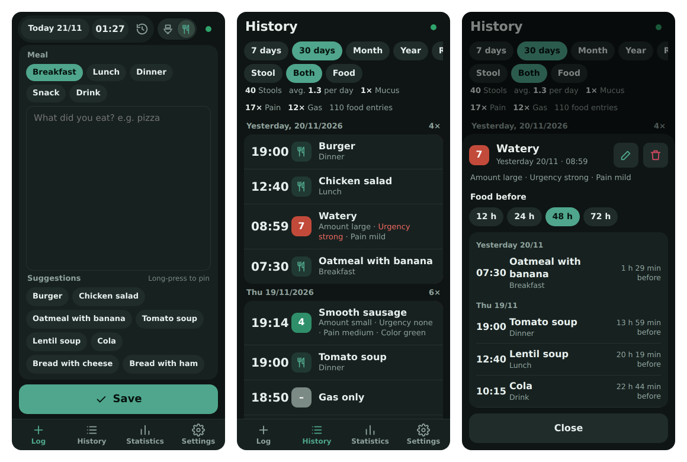

# Configuration

**English** · [Deutsch](CONFIGURATION.de.md)

[Back to the README](../README.md)

## Docker in detail

The [quick start in the README](../README.md#quick-start-docker) shows a short `compose.yml`. Compose files in this repository:

- `docker-compose.yml`: the most important settings (time zone, multiple accounts, food, APK connection, server backups in `./data/backups`), values from `.env`. Hardened: no Linux capabilities, no privilege escalation, read-only file system (only `/data` and `/tmp` are writable).
- [`compose/all-options.yml`](../compose/all-options.yml): every option from [`.env.example`](../.env.example). Copy it together with your `.env` into its own folder, or replace the short file in the repository: `cp compose/all-options.yml docker-compose.yml`. All options are explained under [Configuration](#configuration).
- [`compose/`](../compose/) also has templates without a `.env`: `quickstart.yml` (like the README), `multiuser.yml` (multiple accounts, backups) and `reverse-proxy.yml` (HTTPS proxy, APK). Copy each into its own folder.

Passwords (e.g. `BACKUP_PASSWORD` for encrypted server backups) do not belong in the `compose.yml` but in a `.env` next to it, which you reference with `BACKUP_PASSWORD: ${BACKUP_PASSWORD}`.

> **Special characters in `.env`:** If a value contains a `$` (e.g. for `BACKUP_PASSWORD`), wrap it in single quotes, e.g. `BACKUP_PASSWORD='ab$cd'`. Otherwise Docker Compose reads `$cd` as a variable and silently changes the value.

> Image and variants: The compose files use the prebuilt image `ghcr.io/jamdevlab/gutkeeper` (amd64 and arm64). The tag picks the version: `1` (always the latest 1.x), `1.2` or a fixed version such as `1.2.3` (in `compose/all-options.yml` via `IMAGE_TAG`). Update: `docker compose pull && docker compose up -d`. To build from source: `docker compose -f docker-compose.yml -f docker-compose.dev.yml up -d --build`.

> Write permissions: by default the container runs as user 1000 and writes to `./data`. If the folder belongs to someone else, change `user:` in the compose file (with `compose/all-options.yml`: `PUID`/`PGID` in `.env`; your own IDs: `id -u`, `id -g`) or fix the permissions: `chown -R 1000:1000 data`.

> An overview of all three ways to use the app (server, web app without a server, Android app) with instructions for Android and iPhone is in [docs/INSTALLATION.md](INSTALLATION.md).

## Without a server (just files, all data stays on the device)

The same code also runs without a server. There is then no sync between devices, no sign-in and no server backups (the local app lock by PIN is available here too); entries live only in the device's storage.

```bash
npm run build:static     # creates the dist/ folder
```

`dist/` contains only static files (optionally `APP_NAME`, `APP_LANG=de|en`, `APP_ICON`, `APP_THEME_COLOR`, `ICON_FILE` for your own icon, and `ONBOARDING=0` to turn off the guided first-run dialog, see [App icon](#app-icon)). You can put the folder on any web space with HTTPS and install it as an app in the browser, or use it as the web directory of an app wrapper such as [Capacitor](https://capacitorjs.com) to build an Android app (APK).

Connect to a server later: the serverless app (including the APK) can be connected to your server and disconnected again under *Settings → Storage → Server connection*. The server has to allow the app's origin in `.env`: `CORS_ORIGINS=https://localhost` (Android app built with Capacitor) or the address where you host `dist/` (separate several with commas). The app then signs in with a token in a header (no cookie needed); without `CORS_ORIGINS` the server behaves as before. When connecting, the device's entries are sent to the server; when disconnecting you can load everything from the server onto the device. The server address must be `https://` if the app itself runs over HTTPS (true for the APK).

> **Important:** Without a server, the browser/app storage is the only copy. Back up your data regularly under **Settings → Backup and import** (ideally with a password); the app reminds you (adjustable, default 30 days). The Android app can also do this automatically and encrypted (*Erinnerung und Automatik*, reminder and automatic backup).

## Install as an app on your phone

Chrome (Android) only offers **Install app** over HTTPS (or `localhost`). Open the HTTPS address of your installation (see [Setting up HTTPS](#setting-up-https)) and choose menu ⋮ → *Install app*. Offline use and fingerprint/face unlock also require HTTPS. Instructions for Android and iPhone: [docs/INSTALLATION.md](INSTALLATION.md). The app also has an **Install** button under *Settings → App* when the browser offers it, and the settings have a search field at the top. In *Settings → App* you can switch on **offline mode** ("only on this device"): nothing is synced until you turn it off again. Before deleting data that exists only on the device, the app asks for confirmation (can be turned off).

## Android app (APK)

The ready-made APK is attached to every [GitHub release](https://github.com/JamDevLab/GutKeeper/releases) and needs at least Android 7.0. It works without a server (all data on the device) or connects to your server. To build it yourself: `android-app/` and `node tools/build-apk.js`, see [Way C](INSTALLATION.md#way-c-build-the-android-app-apk-yourself). Two defaults can be changed in your own build:

- HTTPS only (default): the app only connects to `https://` servers, e.g. behind a reverse proxy with your own domain. Without a domain and certificate you can allow http on your home network: `node tools/android-http.js`, then rebuild the APK (`node tools/android-http.js --off` reverts it). The app itself stays a secure context, so device storage encryption, end-to-end encryption, app lock and fingerprint keep working. The connection to the server is unencrypted, though; without end-to-end encryption, login and entries can be read on the network. The app warns when you connect to an http address. In both cases the server needs `CORS_ORIGINS=https://localhost`.
- No Android backup to the Google account (default): `android:allowBackup="false"` in `android-app/android/app/src/main/AndroidManifest.xml`. Android does not copy the app data (health data) to the Google account. Back up through the app instead: export with password, the automatic encrypted backup in *Documents/GutKeeper*, or *Settings → Switch device*. If you want the Google backup anyway, set the value to `true` and rebuild; there is no guarantee the data fully comes back on a new device.

## Setting up HTTPS

Without HTTPS the password and your entries travel unencrypted across your home network, and the browser allows neither installation nor offline use. The encrypted local storage and the end-to-end encryption also need HTTPS (or `localhost`). The app does not ship TLS; put a reverse proxy in front of it.

Without your own domain: in the browser only HTTPS offers installation, offline use, the encrypted device storage and end-to-end encryption. Without a domain there are three ways:

- Android app (APK): it runs in a secure context itself and, when built accordingly, may connect to an http server on your home network (`node tools/android-http.js`, see [way C](INSTALLATION.md)). Then offline use, encrypted device storage, end-to-end encryption, app lock and fingerprint work even without a domain. Traffic to the server stays unencrypted (only on a trusted home network).
- Free address or Tailscale: a free dynamic DNS service (e.g. DuckDNS) gives you a subdomain for which your proxy can get a Let's Encrypt certificate via the DNS challenge. No port needs to be open on your router: the proxy proves ownership of the subdomain with an API token. Point the subdomain at your server's local IP (set it by hand at DuckDNS). Some routers block public names that resolve to a local IP (DNS rebind protection, e.g. FRITZ!Box); add the subdomain as an exception there. Alternatively [Tailscale](https://tailscale.com) can issue HTTPS certificates for addresses like `device.your-net.ts.net`. I have not tested either; the providers' guides apply.
- Without HTTPS in the browser: capture, history, statistics and report work; installing as an app, offline use, the encrypted device storage and end-to-end encryption do not.

With an existing proxy (Nginx Proxy Manager, Caddy, Traefik …):

1. Point the proxy at `<server-ip>:3000`. Cleaner: put both containers in the same Docker network and use `gutkeeper:3000` as the target. Then set `BIND_ADDR=127.0.0.1` in `.env`, and the app is no longer reachable directly over HTTP:

   ```yaml
   services:
     gutkeeper:
       networks: [default, proxy]
   networks:
     proxy:
       external: true   # the Docker network of your proxy container
   ```

2. Set `TRUST_PROXY=1` in `.env` (and set up the password) so the app knows the visitor's real address (see [Security](DATA.md#security-and-privacy)).
3. *Certificate on a home-only network:* Let's Encrypt only checks that you own the domain; it does not need your server to be reachable from the internet. If you own a domain, use the DNS challenge in the proxy (enter provider and API token). The hostname then only has to point to the server's IP in your local DNS (router, Pi-hole), and no router port has to be forwarded.

Tailscale: if you only reach the app over a VPN anyway, Tailscale can provide an HTTPS certificate for your device's name (*Tailscale Serve*), with no domain of your own and no proxy container.

## Configuration

All settings are environment variables (see [`.env.example`](../.env.example)). The short `docker-compose.yml` passes on only `TZ`, `MULTIUSER`, `FOOD_DEFAULT`, `CORS_ORIGINS`, `BACKUP_KEEP` and `BACKUP_PASSWORD`; for all others use [`compose/all-options.yml`](../compose/all-options.yml) (see [Docker in detail](#docker-in-detail)):

| Variable | Default | Meaning |
|---|---|---|
| `APP_NAME` | *(empty)* | Your own name for the app (title, install name, lock screen). Empty = GutKeeper. |
| `APP_ICON` | `bristol` | App icon: `bristol`, `ring`, `guard`, `crest`, `classic`, `shield`, `list`, `diary` (or `1` to `8`) or `custom` (see [App icon](#app-icon)). |
| `APP_THEME_COLOR` | *(matches the icon)* | Color of the splash screen/title bar as a hex value, e.g. `#2f6f5e`. |
| `PORT` | `3000` | Port the server listens on. Fixed to `3000` in the Docker image (exposed through `HOST_PORT`); without Docker you set it yourself. |
| `DATA_DIR` | `./data` | Folder for the database, `session.key`, `settings.json` and backups. Fixed to `/data` in the Docker image (volume `./data`). |
| `HOST_PORT` | `3000` | Port on the host (Compose only). |
| `CORS_ORIGINS` | – | Allowed origin(s) for the serverless app/APK, comma-separated, e.g. `https://localhost`. Empty = no foreign origin allowed. |
| `ALLOWED_HOSTS` | – | Allowed host names, comma-separated, e.g. `gutkeeper.fritz.box,gutkeeper.example.org` (protection against DNS rebinding). IP addresses and `localhost` always work. Set: only these names. Empty: names are allowed (they are only rejected with `NO_AUTH=1`). |
| `BIND_ADDR` | `0.0.0.0` | Address the port is bound to (Compose only). With a reverse proxy in the same Docker network use `127.0.0.1`, so the app is only reachable through the proxy (HTTPS). |
| `TZ` | `Europe/Berlin` | Time zone for backup names and day change. |
| `PUID` / `PGID` | `1000` | User/group ID of the container. |
| `MULTIUSER` | `0` | `1` = multiple accounts with name + password (see [Multiple accounts](#multiple-accounts-optional)). `0` = one person, password only. The password is set in the app on first start, not in `.env`. |
| `FOOD_DEFAULT` | `0` | Default for "Log food" (everyone can change it). |
| `ONBOARDING` | `1` | Guided first-run dialog after the first login, `0` = off. It asks for appearance, food, app lock, encryption and backups (once per account and device, every step can be skipped or revisited with "Back"; the last page summarizes what was set and where to change it later in Settings). For the serverless version/APK this is set at build time: `ONBOARDING=0 npm run build:static` turns it off. |
| `ADMIN_FULL_ACCESS` | `1` | Multi-user only: the admin may use backups and full export (`0` = manage accounts only; an admin can still reset passwords, see [Security](DATA.md#security-and-privacy)). |
| `SESSION_SECRET` | *(empty)* | Optional: fixed key for the sign-in cookies; otherwise it lives in `data/session.key` (not in the backups). |
| `NO_AUTH` | – | `1` = server without any sign-in, **for local tests only** (e.g. development, automated tests). Not for operation; has no effect with `MULTIUSER=1`. |
| `ALLOW_ANY` | – | `1` = turns off the restriction to private networks/VPN. **For tests and development only** (`npm run dev` sets it). Not for operation. |
| `TRUST_PROXY` | `0` | `1` behind a reverse proxy: real client IP from `X-Real-IP`, HTTPS from `X-Forwarded-Proto`. |
| `TRUSTED_PROXY` | – | With `TRUST_PROXY=1`: IP addresses/subnets (IPv4/IPv6, comma-separated, e.g. `172.18.0.0/16,192.168.1.10`) whose forwarded headers are trusted. Empty: any private address (unsafe if other devices share the network). Recommended. |
| `COOKIE_SECURE` | `auto` | Cookie flag `Secure`: `auto`, `1` or `0`. |
| `LOCAL_MONTHS` | `12` | Default for how many months a device stores (`0` = everything). Each device can change this under *Settings → Storage and server*. |
| `BACKUP_KEEP` | `30` | Number of server backups to keep. |
| `BACKUP_INTERVAL_HOURS` | `24` | Interval of the automatic backups in hours (`24` = once per calendar day, `6` = every 6 hours). |
| `BACKUP_PASSWORD` | *(empty)* | Encrypts all server backups (AES-256, file extension `.db.enc.json`). Restoring in the app works with the same password. Without it they cannot be opened; `node server/cli.js decrypt` decrypts them by hand. |
| `BACKUP_DIR` | `DATA_DIR/backups` | Folder for the server backups. `compose/all-options.yml` sets it to `/backups` (the host folder comes from `BACKUP_HOST_DIR`); the short `docker-compose.yml` keeps the backups in `./data/backups`. |
| `BACKUP_HOST_DIR` | `./data/backups` | `compose/all-options.yml` only: folder on the host for the server backups, e.g. another disk on the NAS. It must exist and be writable for `PUID`/`PGID`. Without Docker, `BACKUP_DIR` sets the folder. |

## Food (optional)

Logging food is off by default (default for all accounts: `FOOD_DEFAULT=1`). Turn it on under **Settings → App → Log food**. With a server the setting applies to all devices that access the server (without a server only to this device). Turning it off only hides it and deletes nothing.

- Logging: a small icon-only button (toilet | fork) at the top right switches between stool and food. With touch you can also swipe (left = food, right = stool). For food you enter the meal (suggested by time of day), a short text and, if needed, date/time. Recently eaten foods are offered as quick picks.
- History: tapping an entry opens a detail view. For a stool entry it shows the food before (window of 12/24/48/72 h, with "5 h before"); for a food entry it shows the entries afterwards. The pencil at the top right opens the edit window; editing and deleting still work by swiping. The filter *Stool | Both | Food* shows both in one list.
- Data: food lives in its own table (`foods`) in the same database file, so backups and restore stay consistent. It syncs between devices like stool. *Delete all data* removes food too; *Delete food data* removes only food. The JSON backup includes food; in addition it can be exported and imported separately as its own CSV file (*Settings → Backup and import → Food (CSV)*: date, time, meal, food). The import recognizes food CSV automatically.
- Limits: no photos and no analysis of "triggers" (the app only shows, it does not interpret). Statistics and CSV do not include food yet; the PDF report includes it on request.



Meal times: which meal is preselected in the *Food* tab depends on the time of day. You can change the times for all accounts in the file `data/settings.json` (restart the container after saving):

```json
{ "mealTimes": { "breakfastUntil": "10:30", "lunchUntil": "15:00", "snackUntil": "17:00", "dinnerUntil": "21:30" } }
```

A template with the settings that have defaults (meal times, number of suggestions, color shades) is in [`docs/settings.example.json`](settings.example.json): copy it to `data/settings.json` and change only what you need.

Breakfast applies until the first time, then lunch, snack and dinner; after the last time it is snack. The four times (`HH:MM`) must be ascending, otherwise the defaults (as in the example) apply and the log warns. The serverless version always uses the defaults.

Number of suggestions: how many dishes appear under *Recently eaten* is set in the same file: `"recentFoods": 8` (1 to 30, default 8).

Defaults for note tags and pinned food: `data/settings.json` can also preset the tags below the note and the pinned dishes for all accounts:

```json
{ "noteTags": ["Coffee", "Stress", "Medication", "Lactose"], "foodPins": ["Oatmeal", "Chamomile tea"] }
```

These are only defaults: everyone can still change the lists on their device. The tags apply as long as a person has not edited the list themselves (also on devices already set up), and "Restore defaults" returns to them. The pinned dishes are taken over as long as nothing was ever pinned or unpinned on the device. Entries appear exactly as written in the file (they are not translated). Limits as in the app: at most 24 tags of 30 characters each and at most 12 pinned dishes; duplicates and invalid entries are skipped (warning in the log). The serverless version uses the built-in defaults.

## Multiple accounts (optional)

By default GutKeeper is meant for one person. With `MULTIUSER=1` every person gets their own account with username and password, and the data is strictly separated.

- Setup: on first open you create the first account (name and password). It becomes the admin and takes over existing data, including data from single-user mode. To confirm, use the one-time code from the server log (`docker compose logs`).
- Admin: under *Settings → User management* you create accounts, disable them, reset passwords and delete accounts (confirmed by typing the name). The last admin is protected. The original first account can be deleted too; the server does not depend on a particular account ID. The admin sees no entries of other people in the app.
- Temporary password: the admin knows the password of an account they created or reset (also via `reset-password`). Until the person changes it, the app shows a hint under *Settings → Account and security* ( with a button that jumps to the "Change password" form) and, if the guided setup is not turned off (`ONBOARDING=0`), a first step "Set your own password". Once the person changes it themselves the hint disappears. `/api/me` and sign-in report `pwTemp` for this. The account created during setup is never temporary.
- Passwords: at least 8 characters, stored as a scrypt hash. Everyone signs in once on each device with name and password and then stays signed in (see [Security and privacy](DATA.md#security-and-privacy)); a local PIN for the device is optional. Everyone changes their own password under *Settings → Account and security*; this signs out the other devices. Wrong attempts are slowed down per address and per account.
- Log food is a per-account setting; `FOOD_DEFAULT=1` sets the default for everyone who has not changed it.
- Backups and full export (admin): under *Settings → Administration* you can create backups, download them (also encrypted with a password), restore them for a single account, and export the data of one or all accounts (optionally encrypted). With `ADMIN_FULL_ACCESS=0` this is disabled and the admin only manages accounts. For real separation, run one container per person.
- Encrypted files (`*.enc.json`, AES-256-GCM, key via PBKDF2) can be opened on import in the app. Decrypt an encrypted database backup on the server: `docker compose exec gutkeeper node server/cli.js decrypt FILE OUTPUT`. The password cannot be recovered.
- Forgot the password (admin): `docker compose exec gutkeeper node server/cli.js reset-password NAME [NEW_PASSWORD]` (without a password argument the command reads it from standard input; in single-user mode without a name: `reset-password [NEW_PASSWORD]`; more commands: `list-users`, `logout-all [NAME]` signs out all sessions of an account, `delete-user NAME` deletes an account with its data (not the last admin and not the last account), `decrypt`).
- Import: under *Settings → Backup and import* choose *Merge* (same IDs are updated) or *As new entries (new IDs)* so that nothing is overwritten.
- Import preview: only JSON backups (including encrypted ones) and CSV files are accepted; anything else gives a clear error. Before anything is imported, the app shows a preview: number of entries and food rows, date range, how many are new, already present or would update existing ones, and the mode in use (*Merge* or *As new entries*), which you can switch there. Only "Importieren" (Import) writes the data. For encrypted files the password prompt comes first.
- Origin header: every JSON backup (also the encrypted one, inside the encrypted part) contains `origin` with the account (name and ID; no name in single-user mode), a random installation id, the kind (`server` or `standalone`) and the export time. The server creates its id once as a random value in `data/instance.id` (not derived from any key; exposed as `instance` in `/api/config`); the serverless version/APK creates a device id. On import the app compares: if the file comes from another account on the same server, it shows a prominent warning ("This file comes from the account 'x'. You are signed in as 'y'."), "Abbrechen" (Cancel) is the primary action, and you can choose "Als Kopie importieren (neue IDs)" (import as copy) or "Trotzdem importieren" (import anyway). From another installation (other server, app to server, new device) it only shows a note; that is the normal migration path. Older files without the header show "origin unknown". The server's database backups (`*.db`) are not JSON exports and carry no header; the admin full export does.
- Devices: local data is separated per account (namespace in the browser). When signing out you can delete the local data of this device. On a shared device an account never sees another account's data, not even its unsent changes.

## App icon

You can change the icon without code via an environment variable:

| `APP_ICON` | Look |
|---|---|
| `bristol` (default) or `3` | the seven Bristol colors as dots in two rows |
| `ring` or `6` | the seven Bristol colors as a ring |
| `guard` or `8` | **neutral**: a small shield inside a ring of Bristol dots |
| `crest` or `7` | **neutral**: a shield outline with the Bristol ring inside |
| `classic` or `1` | three stacked bars in mint and cream, reveals nothing |
| `shield` or `5` | **neutral**: a shield with a check mark |
| `list` or `4` | **neutral**: three entries with a dot and a bar each |
| `diary` or `2` | **neutral**: an open diary with a bookmark |
| `custom` | your own image |

Custom icon: put a square PNG (at least 512×512 px) at `data/icon.png` and set `APP_ICON=custom`. Optionally add `data/icon-maskable.png`: an image whose motif lies within the inner 60 %, so Android can crop it round or rounded. Then restart the container. Set the splash color with `APP_THEME_COLOR`. If the file is missing or not a PNG, the app falls back to `bristol` and writes a warning to the log.

Serverless version: choose a built-in icon with `APP_ICON=<name> npm run build:static` (names as in the table). For your own image use `APP_ICON=custom ICON_FILE=path/to/icon.png npm run build:static` (optionally `ICON_MASKABLE_FILE=…`, like `icon-maskable.png` above). For a self-built Android app (APK) set the icon in Android Studio, see [docs/INSTALLATION.md](INSTALLATION.md).

Chrome picks up a changed icon of an already installed app only with a delay. If it does not appear, uninstall the app from the home screen and install it again. The built-in icons are generated by [`tools/make-icons.js`](../tools/make-icons.js) (needs Chrome or Edge, no npm packages); use it as a template for your own designs. In the Android app you can switch between all eight icons under Options.
